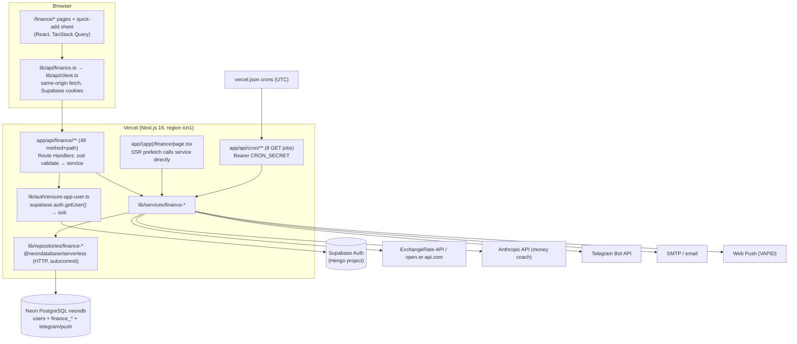

# Current architecture (existing, verified)

Sources:

- Luyra: `luyra-web` @ `f63fcb8`
- H-Space: this repo @ `b4ded30`

Paths prefixed `luyra:` are in `luyra-web`. Unprefixed paths are in this repo.

## 1. Luyra finance today

**VERIFIED** facts:

- **Identity.** Every finance route calls `ensureAppUserId()`
  (luyra:`lib/auth/ensure-app-user.ts`), which runs
  `supabase.auth.getUser()` against the session cookie. The user id is
  the token's `sub`.
  - The first time a user is seen, it is mirrored into Neon `users` with
    that same UUID.
  - The user id is never read from the request body or path.
  - API routes skip the session-refresh middleware (`proxy.ts` excludes
    `/api`).
- **Envelope.**
  - Success is `{ "data": T }` with status 200, or 201 on create.
  - Errors are `{ "error": { "code", "message" } }` with these codes:
    - `VALIDATION_ERROR` → 422 (only the first zod issue)
    - `NOT_FOUND` → 404
    - `CONFLICT` → 409
    - `UNAUTHORIZED` → 401
    - `INTERNAL_ERROR` → 500
  - `lib/api/client.ts` is the single switch point the frontend uses.
- **Data access.** It uses the Neon HTTP driver, so every statement
  autocommits. Only three code paths are atomic, via
  `sql.transaction([...])`:
  - budget-plan apply
  - merchant-alias merge
  - recurring occurrence apply
- **Money.** `amount_krw` is the canonical amount for every total. For a
  USD entry:
  - `amount_usd` holds the *original* amount
  - `exchange_rate` holds USD→KRW
  - the server computes `Math.round(original × rate)`
- **Time.** "Today" and "this month" use **Asia/Seoul**
  (`lib/finance-cron-time.ts`). The known exceptions are listed in
  [DATABASE-SCHEMA.md §6](DATABASE-SCHEMA.md#6-dates-and-time-zones).
- **Cron.** All jobs are `GET` with `Authorization: Bearer <CRON_SECRET>`.
  The schedules are in UTC (see [API-CONTRACT.md §6](API-CONTRACT.md#6-scheduled-jobs-cron)).
- **AI.** The money coach calls Anthropic with a forced tool call. Nothing
  it returns is stored on the server, and `finance_ai_insights` is
  unused. The UI's "Apply" button does send the AI-suggested amount to
  `PUT /budgets`.
- **Tests.** Vitest covers the pure functions (recurring schedule, budget
  plan, financial health, merchant names, amount entry and others) plus
  three service tests that use **mocked** repositories. There are no
  repository or database tests.

### Feature inventory

| Feature | Screen | Endpoints (see API-CONTRACT) | Tables | Jobs | State |
|---|---|---|---|---|---|
| Overview / financial health | `/finance` | `GET overview` | transactions, categories, budgets, prefs, contributions, FX | — | Live |
| Analytics | `/finance/analytics` | `GET analytics` | transactions, categories, payment methods | — | Live |
| Transactions (CRUD, filter, bulk, suggestions) | `/finance/transactions`, quick-add on every page | `transactions*` | transactions, categories, payment methods | — | Live |
| Categories, payment methods | `/finance/settings` | `categories*`, `payment-methods*` | categories, payment methods | — | Live |
| Budgets and alerts | `/finance/budgets` | `budgets*` | budgets, push_budget_alerts | budget-alerts, push-budget-alerts | Live |
| Monthly review and next-month plan | `/finance/review` | `review`, `review/plan` | budgets, transactions, prefs | — | Live |
| Savings goals and contributions | `/finance/savings` | `savings*` | savings_goals, savings_contributions | — | Live. Auto-plan columns are unused |
| Recurring | `/finance/transactions` (sheet) | `recurring*` | recurring_transactions, transactions, FX | recurring | Live |
| Subscriptions (detected) | `/finance/subscriptions` | `subscriptions*` | transactions, subscription_status, aliases | — | Live |
| Merchant names (aliases) | `/finance/subscriptions` | `merchant-names` | description_aliases | — | Live |
| Templates | quick-add, transactions | `templates*` | transaction_templates | — | Live (max 12, KRW only) |
| Exchange rate | transaction sheet | `exchange-rate` | exchange_rates (global) | — | Live (60-minute cache, fallback 1370) |
| Reports (weekly, monthly) | `/finance/settings`, `/reports-print` | `reports/*` | many | weekly-summary, monthly-report | Live |
| Preferences | `/finance/settings`, `/finance/review` | `preferences` | preferences | — | Live. Several columns are unused |
| Telegram / email delivery | `/finance/settings` | `telegram/send`, `email/*` | telegram_accounts, preferences | report crons, reminders | Live |
| AI money coach | `/finance/settings` | `money-coach` | read-only | — | Live (Anthropic) |
| Export | `/finance/settings` (link) | `export` | transactions | — | Live, no envelope |
| `finance_ai_insights` | — | — | ai_insights | — | **Schema only, unused** |

Things that are not finance but share the Neon database:

- Telegram linking (`/api/telegram/*`)
- web-push subscription routes
- learning, tasks, habits and goals tables

These are **out of scope**. Don't copy them.

## 2. H-Space `finance-api` today

**VERIFIED** (`finance-api/**`, root `build.gradle`):

| Item | State |
|---|---|
| `FinanceApiApplication` | Scans `financeapi`, `securityapi`, `apicore`. Entities and JPA repositories come from `financeapi` + `securityapi`, so it embeds `security-api`'s filter chain, `GlobalExceptionHandler` and the `users` entity. Same model as `hub-api` (decision D2 in the migration plan). |
| Security | `WebSecurityConfig` (security-api) is stateless JWT and `anyRequest().authenticated()`. `/api/finance/**` therefore needs a valid, unrevoked, email-verified H-Space access token. |
| `FinanceOpenApiConfig` | Swagger group `finance` (`/api/finance/**`) |
| Profiles | `dev`, `prod` and `test` are committed. `local` is git-ignored, as in the other modules. `ddl-auto=validate` everywhere. Test schema `finance_api_test`. |
| Flyway | `flyway-core` is on the classpath, but there is **no finance migration location and no history table**. Today the auto-configured Flyway only applies `security-api`'s `db/migration` (**INFERRED**: this is the default when no `FlywayMigrationStrategy` is defined). |
| Tests | `FinanceApiApplicationTests`: the context loads, and `GET /api/finance/v1/accounts` → 401. That path doesn't exist in Luyra. |
| Domain code | None: no entities, repositories, services, controllers or migrations |

### Gaps and blockers found in the scaffold

| # | Finding | Label |
|---|---|---|
| G1 | `spring-security-oauth2-core` is missing from `finance-api`'s dependencies. `hub-api` needs it because `UserPrincipal` implements `OAuth2User`, so `@AuthenticationPrincipal UserPrincipal` won't compile in `finance-api` without it. | VERIFIED |
| G2 | There is no `FinanceFlywayConfig` with its own location and history table. Without one, finance migrations would land in `security-api`'s history and break its startup once security adds V7 (the reasoning behind migration-plan decision D4). | VERIFIED |
| G3 | `application-prod.yml` drifts from `hub-api`'s. It has a pool of 20 (`hub-api` uses 3 with min-idle 1, `docs/database.md` says 5), no `sslmode=require`, no `API_DOCS_ENABLED` gate on Swagger, and no `run-security-migrations: false` equivalent. | VERIFIED |
| G4 | There is no CI image job, no compose service and no Caddy route for `/api/finance/*` (`.github/workflows/ci.yml`, `deploy/`). | VERIFIED |
| G5 | `GlobalExceptionHandler` has no handler for `MethodArgumentTypeMismatchException` (non-UUID path id), `DataIntegrityViolationException` or `ConstraintViolationException`. They fall through to the catch-all: **500 with `ex.getMessage()` in `data`**, which can echo SQL or constraint text. This is a `security-api` change and must go in its own PR. It is the same gap as migration-plan audit finding 1.6. | VERIFIED |
| G6 | No 422 status exists. Validation answers **400** with a per-field map in `data`. Luyra answers 422 with `error.code`. | VERIFIED |
| G7 | The smoke test probes a fictional path (`/api/finance/v1/accounts`). | VERIFIED |
| G8 | Memory budget. The VPS guide sizes one API container at 768 MB on a 2 GB host. A third JVM (security + hub + finance) may not fit, so plan the heap and container limit before deploying (decision D-11). | INFERRED |

## 3. Existing vs proposed: summary

| Concern | Luyra (existing) | `finance-api` (proposed, see SPRING-ARCHITECTURE) |
|---|---|---|
| Identity | Supabase cookie, `sub` | H-Space JWT (`UserPrincipal.id`) |
| Isolation | App-level `user_id` filters, no RLS | Every repository method takes `userId`; referenced ids checked; composite FKs |
| Atomicity | Mostly autocommit | `@Transactional` service methods |
| Money | numeric → JS `Number`, `Math.round` | `NUMERIC` ↔ `BigDecimal`, explicit `RoundingMode` |
| Schema authority | Hand-applied SQL files | Flyway, own history table |
| Jobs | Vercel Cron → HTTP | Spring `@Scheduled` + DB lock + idempotency keys |
| Envelope | `{data}` / `{error}` | `ApiResponse` + a frontend adapter (decision D-5) |
