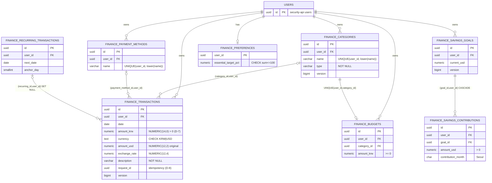

# Finance ERD

Column detail and findings: [DATABASE-SCHEMA.md](DATABASE-SCHEMA.md).

## 1. Existing Luyra schema (from migrations — UNVERIFIED against live)

```mermaid
erDiagram
    USERS ||--o{ FINANCE_CATEGORIES : owns
    USERS ||--o{ FINANCE_PAYMENT_METHODS : owns
    USERS ||--o{ FINANCE_TRANSACTIONS : owns
    USERS ||--o{ FINANCE_BUDGETS : owns
    USERS ||--o{ FINANCE_SAVINGS_GOALS : owns
    USERS ||--o{ FINANCE_SAVINGS_CONTRIBUTIONS : owns
    USERS ||--o{ FINANCE_RECURRING_TRANSACTIONS : owns
    USERS ||--o{ FINANCE_TRANSACTION_TEMPLATES : owns
    USERS ||--o| FINANCE_PREFERENCES : has
    USERS ||--o{ FINANCE_AI_INSIGHTS : "owns (unused)"
    USERS ||--o{ FINANCE_SUBSCRIPTION_STATUS : owns
    USERS ||--o{ FINANCE_TRANSACTION_DESCRIPTION_ALIASES : owns
    USERS ||--o{ FINANCE_PUSH_BUDGET_ALERTS : owns
    USERS ||--o| TELEGRAM_ACCOUNTS : links
    USERS ||--o{ PUSH_SUBSCRIPTIONS : registers

    FINANCE_CATEGORIES |o--o{ FINANCE_TRANSACTIONS : "category (NO ACTION)"
    FINANCE_PAYMENT_METHODS |o--o{ FINANCE_TRANSACTIONS : "method (NO ACTION)"
    FINANCE_RECURRING_TRANSACTIONS |o--o{ FINANCE_TRANSACTIONS : "generates (SET NULL)"
    FINANCE_CATEGORIES ||--o{ FINANCE_BUDGETS : "budget (NO ACTION, no unique)"
    FINANCE_CATEGORIES |o--o{ FINANCE_RECURRING_TRANSACTIONS : category
    FINANCE_PAYMENT_METHODS |o--o{ FINANCE_RECURRING_TRANSACTIONS : method
    FINANCE_CATEGORIES |o--o{ FINANCE_TRANSACTION_TEMPLATES : category
    FINANCE_PAYMENT_METHODS |o--o{ FINANCE_TRANSACTION_TEMPLATES : method
    FINANCE_SAVINGS_GOALS ||--o{ FINANCE_SAVINGS_CONTRIBUTIONS : "contributions (CASCADE)"
    FINANCE_CATEGORIES ||--o{ FINANCE_PUSH_BUDGET_ALERTS : "dedupe (CASCADE)"

    USERS {
      uuid id PK "Supabase sub"
      varchar email "not unique"
      varchar timezone "unused"
      varchar default_currency "unused"
    }
    FINANCE_TRANSACTIONS {
      uuid id PK
      uuid user_id FK
      uuid recurring_id FK "nullable"
      date date
      varchar type "income|expense"
      uuid category_id FK "nullable"
      varchar description "nullable!"
      numeric amount_krw "canonical, no check"
      numeric amount_usd "original amount"
      numeric exchange_rate
      uuid payment_method_id FK
      text currency "no check"
      text note
      timestamptz created_at
      timestamptz updated_at
    }
    FINANCE_CATEGORIES {
      uuid id PK
      uuid user_id FK
      varchar name "no unique"
      varchar icon
      varchar color
      varchar type "income|expense|both, nullable"
      text spending_class
      timestamptz created_at
    }
    FINANCE_PAYMENT_METHODS {
      uuid id PK
      uuid user_id FK
      varchar name "no unique"
      varchar icon
      timestamptz created_at
    }
    FINANCE_BUDGETS {
      uuid id PK
      uuid user_id FK
      uuid category_id FK
      numeric amount_krw
      text alert_month
      int alert_level
      timestamptz created_at
      timestamptz updated_at
    }
    FINANCE_SAVINGS_GOALS {
      uuid id PK
      uuid user_id FK
      text name
      text icon
      text color
      numeric target_usd
      numeric current_usd "running total"
      date deadline
      text purpose
      numeric auto_monthly_usd "unused"
      smallint reminder_day "unused"
      timestamptz created_at
      timestamptz updated_at
    }
    FINANCE_SAVINGS_CONTRIBUTIONS {
      uuid id PK
      uuid user_id FK
      uuid goal_id FK
      numeric amount_usd "> 0"
      text contribution_month "YYYY-MM"
      text source "manual|planned"
      timestamptz created_at
    }
    FINANCE_RECURRING_TRANSACTIONS {
      uuid id PK
      uuid user_id FK
      text type
      numeric amount_krw "> 0"
      numeric amount_usd
      numeric exchange_rate
      text currency "KRW|USD"
      text description
      uuid category_id FK
      uuid payment_method_id FK
      text frequency
      date next_date
      date last_applied
      smallint anchor_day "1..31"
      bool is_active
      timestamptz created_at
    }
    FINANCE_TRANSACTION_TEMPLATES {
      uuid id PK
      uuid user_id FK
      text type
      text description
      numeric amount_krw "> 0"
      uuid category_id FK
      uuid payment_method_id FK
      text currency "never written"
      timestamptz created_at
    }
    FINANCE_PREFERENCES {
      uuid user_id PK
      numeric target_savings_rate
      numeric essential_target_pct
      jsonb budget_warning_thresholds
      jsonb quiet_hours
      text finance_report_email
      text report_markers "4 last-sent columns"
      timestamptz updated_at
    }
    FINANCE_EXCHANGE_RATES {
      uuid id PK
      varchar base_currency
      varchar target_currency
      numeric rate
      timestamptz fetched_at
    }
    FINANCE_AI_INSIGHTS {
      uuid id PK
      uuid user_id FK
      text insight_type
      jsonb evidence
    }
    FINANCE_SUBSCRIPTION_STATUS {
      uuid id PK
      uuid user_id FK
      text subscription_key "no unique"
      text display_name
      text status
    }
    FINANCE_TRANSACTION_DESCRIPTION_ALIASES {
      uuid id PK
      uuid user_id FK
      text canonical_description
      text variant_description
      text normalized_key "no unique"
    }
    FINANCE_PUSH_BUDGET_ALERTS {
      uuid user_id PK
      uuid category_id PK
      char month_key PK
      text last_status
      timestamptz sent_at
    }
    TELEGRAM_ACCOUNTS {
      uuid user_id PK
      text chat_id "partial unique"
    }
    PUSH_SUBSCRIPTIONS {
      uuid id PK
      uuid user_id FK
      text endpoint "unique"
    }
```

`FINANCE_EXCHANGE_RATES` has no relationship; it is a global cache.

## 2. Proposed destination (H-Space PostgreSQL) — PROPOSED

The proposal differs from the existing schema in these ways:

- Owner FKs point at H-Space `users(id)` (`security-api`'s table). Luyra's
  `users` table is **not** copied.
- Composite tenant FKs make "parent belongs to the same user" a database
  fact.
- The missing unique constraints are added.
- Unused tables and columns are dropped (decision D-9).
- `version` is added for optimistic locking on mutable aggregates.

Tables not drawn here keep their source shape plus the §5 constraints
from DATABASE-SCHEMA:

- templates
- exchange rates
- subscription status
- aliases
- push alerts

Telegram and push tables move only together with the notification phase
(Phase 6). Their ownership against H-Space's own planned
`kori_telegram_links`/`kori_push_subscriptions` (migration-plan phase 2b)
is decision D-10.
