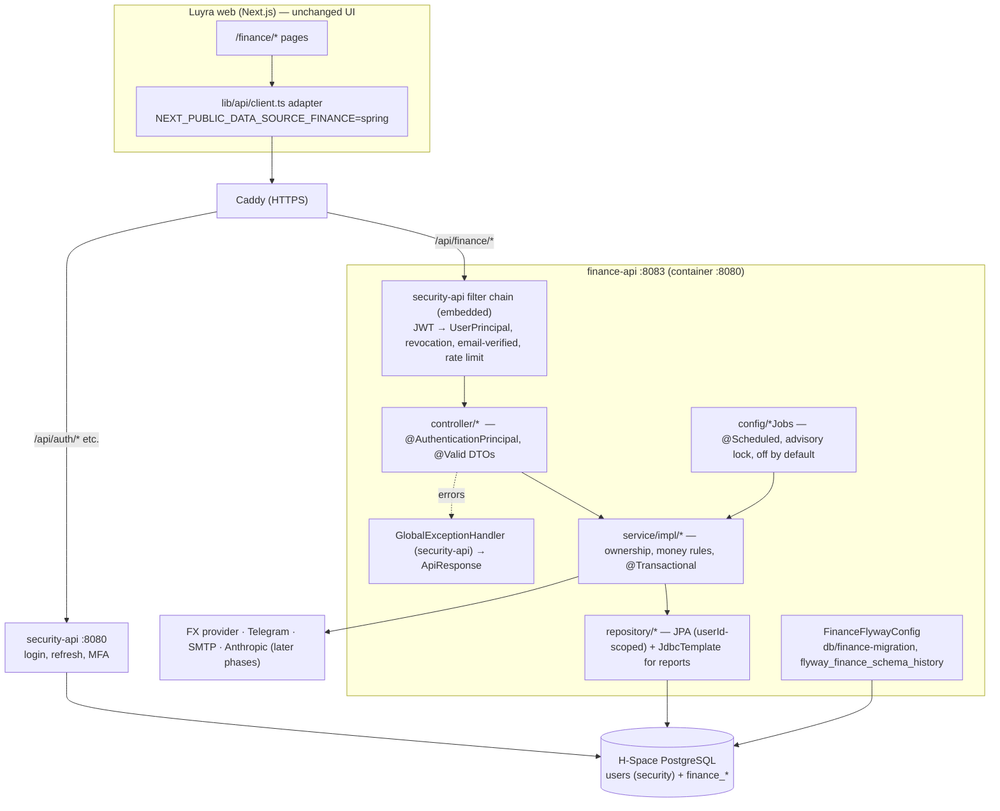

# Proposed Spring architecture for `finance-api` (PROPOSED)

The target module is `finance-api`, decided 2026-11-03 (D-1). Nothing in
this document is built yet. It follows `hub-api`'s conventions, which are
already in production, so that both modules work the same way.

## 1. Context



## 2. Module changes (Phase 1 prerequisites)

**`build.gradle` (root, `project(':finance-api')`)** — add only:

- `org.springframework.security:spring-security-oauth2-core`, the same
  reason as in `hub-api` (`UserPrincipal implements OAuth2User`, gap G1)

No other new framework. Specifically:

- **No MyBatis**: reporting uses `NamedParameterJdbcTemplate`, which
  `spring-boot-starter-data-jpa` already brings in.
- **No ShedLock**: Postgres advisory locks are enough.
- **No Testcontainers**: tests use the existing real `jwt_auth_test`
  database.

**Configuration**

| File | Change |
|---|---|
| `config/FinanceFlywayConfig.java` | Copy of `HubFlywayConfig`: location `classpath:db/finance-migration`, table `flyway_finance_schema_history`, `baselineOnMigrate(true)`, `baselineVersion("0")`, and `finance.flyway.run-security-migrations` (default true; **false in prod**). |
| `application-prod.yml` | Align with `hub-api`: pool `${DB_POOL_MAX_SIZE:3}` / min-idle 1, `sslmode: require`, Swagger behind `API_DOCS_ENABLED`, `finance.flyway.run-security-migrations: false`, `finance.jobs.enabled: ${FINANCE_JOBS_ENABLED:false}` (gap G3). |
| `application-test.yml` | Already uses schema `finance_api_test`. Add `finance.jobs.enabled: false`. |
| `application.yml` | `finance.zone: Asia/Seoul`. Placeholders for FX/Telegram/SMTP/Anthropic are added only in the phases that need them, and never with real defaults. |

**Separate PRs, not finance work**

- `security-api` `GlobalExceptionHandler` should map these exceptions to
  400/404/409 and stop echoing `ex.getMessage()` from the catch-all
  (gap G5):
  - `MethodArgumentTypeMismatchException`
  - `ConstraintViolationException`
  - `DataIntegrityViolationException`

  This touches every module, so it must be its own reviewed change.
- CI image matrix, compose service and Caddy route for `finance-api`
  (gap G4) come in Phase 7.

## 3. Packages

```text
finance-api/src/main/java/com/henheang/financeapi/
  FinanceApiApplication.java          (exists)
  config/
    FinanceOpenApiConfig.java         (exists)
    FinanceFlywayConfig.java
    FinanceClockConfig.java           Clock bean pinned to Asia/Seoul
    FinanceJobsConfig.java            @EnableScheduling when finance.jobs.enabled
  controller/
    CategoryController, PaymentMethodController, TransactionController,
    BudgetController, SavingsGoalController, RecurringRuleController,
    TemplateController, PreferencesController, OverviewController,
    ReportController, SubscriptionController, MerchantNameController,
    ExchangeRateController, ExportController
  domain/                             JPA entities (extend security-api BaseEntity
                                      where the table has id/created_at/updated_at/version)
    FinanceCategory, FinancePaymentMethod, FinanceTransaction, FinanceBudget,
    FinanceSavingsGoal, FinanceSavingsContribution, FinanceRecurringRule,
    FinanceTransactionTemplate, FinancePreferences, FinanceExchangeRate, ...
    money/Money.java, money/KrwConverter.java      (pure, unit-tested)
    schedule/RecurringSchedule.java                (pure port of recurring-schedule.ts)
  repository/
    *Repository (Spring Data; every finder has userId)  e.g. findByIdAndUserId
    report/FinanceReportQueries (NamedParameterJdbcTemplate, userId-first SQL)
  service/  + service/impl/
  payload/<area>/                    Request classes (Lombok + Bean Validation),
                                      Response records with static from(...)
  exception/                         only if a finance-specific error code is needed
```

**Layering rules**

These are the same as `hub-api`'s Inbox, which is the reference
implementation.

- A controller takes `@AuthenticationPrincipal UserPrincipal` and passes
  `principal.getId()` down. The user id never comes from a body, path or
  query.
- Services hold **all** authorization:
  - Every referenced id (category, payment method, recurring rule, goal)
    is loaded with `findByIdAndUserId`, or checked with
    `existsByIdAndUserId`, before it is used.
  - A miss answers **404** (`ResourceNotFoundException`), so ids don't
    leak.
- Repositories have no unscoped finder. Cron-wide queries (due rules,
  report recipients) live in clearly named `*ForJob` methods that are
  used only by job classes.
- Responses are wrapped by `BaseController.ok(...)`. Exceptions are thrown,
  never formatted in the controller.
- Request DTOs are allowlists. If the frontend contract allows it, enable
  `FAIL_ON_UNKNOWN_PROPERTIES` for finance payloads only. Luyra's zod
  silently strips unknown fields, so decide in D-5 and test it.
- Entities that lack `updated_at`/`version` in the source get those
  columns in the destination migration, so they can extend `BaseEntity`.
  This applies to categories, payment methods, recurring rules and
  templates.

## 4. Financial correctness rules

| Topic | Rule |
|---|---|
| Money type | `BigDecimal` in Java, `NUMERIC` in SQL. No `double`/`float` anywhere in finance code. A test greps for them, or an ArchUnit-style check is added later. |
| Scales | KRW `NUMERIC(14,0)` (whole won, D-7); USD `NUMERIC(12,2)`; FX rate `NUMERIC(14,6)`; percentages are computed, never stored as floats. |
| Conversion | `amountKrw = originalUsd.multiply(rate).setScale(0, RoundingMode.HALF_UP)`. It lives in one place (`KrwConverter`). The server computes it, and any KRW the client sends for USD is ignored, as Luyra already does. |
| Parity note | Luyra rounds a binary-double product. Exact `HALF_UP` can differ by ₩1 when the true product is exactly `.5`. Accept this, document it, and cover it with a golden test (D-7). |
| Original amount and rate history | Every USD transaction keeps `amount_usd`, `exchange_rate` and `currency`. A recurring occurrence uses the stored rate on or before its date (Luyra rule). `finance_exchange_rates` is append-only with a retention policy (D-12). |
| Percentages | `usagePct = spent*100/budget` with `HALF_UP` to an integer, the same thresholds as Luyra, and the status uses the **rounded** value as the overview does. Telegram alert levels use the unrounded value in Luyra. Unify on one rule and document it (D-13). |
| Dates | `LocalDate` for business dates, `YearMonth` for months, `Instant` for audit. The `Clock` bean (Asia/Seoul) is injected; there is no `LocalDate.now()` without it. Ranges are half-open `[start, end)`. |
| Seoul fixes | Contribution month, push-alert month, lookback and suggestion window all use Seoul (DATABASE-SCHEMA §6). |
| Atomicity | Every multi-statement write is one `@Transactional` service method: <br>• contribution + goal balance <br>• bulk ops <br>• plan apply <br>• recurring apply <br>• category delete-if-unused <br>• alias merge |
| Concurrency | • Budgets: `INSERT … ON CONFLICT (user_id, category_id) DO UPDATE`. <br>• Subscription status and aliases: the same pattern on their new unique keys. <br>• Goal balance: `UPDATE … SET current_usd = current_usd + :amt WHERE id=:id AND user_id=:uid` inside the transaction. <br>• Entity edits: `@Version` → 409 on conflict (handler already exists). <br>• Template cap: lock the user's preferences row (`SELECT … FOR UPDATE`) before count+insert. |
| Duplicate requests | `POST /transactions` and `POST /savings/{id}/contributions` accept an `Idempotency-Key` header (UUID), stored as `request_id` with `UNIQUE (user_id, request_id)`. A replay returns the original row (D-8). |
| Idempotent jobs | Recurring keeps the partial unique `(recurring_id, date)` + `ON CONFLICT DO NOTHING` + guarded `next_date` update. Report jobs keep per-channel period markers. Each job takes `pg_try_advisory_xact_lock(<job id>)`, so a second instance skips. |
| Category reassignment | Deleting a category still referenced → 409 with usage counts (Luyra behaviour). Bulk recategorize checks ownership and type compatibility in the same transaction. Single create/update also checks type compatibility (new: Luyra trusts the UI). |
| Savings consistency | `current_usd` = opening balance + Σcontributions. Never recompute it from contributions during import. Contributions stay append-only (no edit/delete endpoint exists). |
| Reports = ledger | Every aggregate is a SQL `SUM` over `finance_transactions` with the same filters as the list. Reconciliation tests assert that report totals equal summed list results for synthetic months. |
| AI | It never produces stored numbers. The coach output is advisory. "Apply" goes through the normal budget validation, and the server records `source=coach` in the audit log (Phase 6). |
| Logging | Log ids, counts and outcomes. Never log amounts, descriptions, notes or emails (`AGENTS.md`: no PII in logs). |

## 5. Scheduled jobs (Phase 5–6)

| Luyra cron (UTC) | Spring job | Notes |
|---|---|---|
| recurring `0 0 * * *` | `RecurringJob` `cron = "0 0 9 * * *"`, `zone = "Asia/Seoul"` | Writes ledger rows |
| budget-alerts / push-budget-alerts `0 10 * * *` | `BudgetAlertJob` 19:00 KST | Telegram/push channel ownership: D-10 |
| spending-spike `0 12 * * *` | 21:00 KST | |
| daily-reminder `0 3`, daily-log-reminder `0 11` | 12:00 / 20:00 KST | |
| weekly-summary `0 0 * * 1` | Monday 09:00 KST | Markers |
| monthly-report `0 2 * * *` | 11:00 KST daily | Markers make it idempotent |

All jobs are **disabled unless `finance.jobs.enabled=true`**. That flag
goes on only after the matching Vercel cron entry is removed, so the old
and new jobs never both run against the same data (see
AUTH-AND-DATA-MIGRATION §7).
