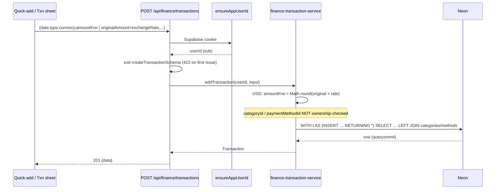
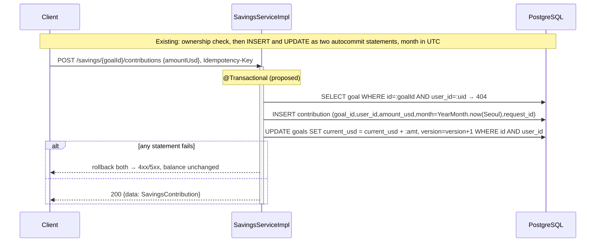
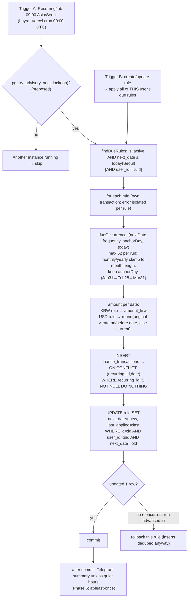
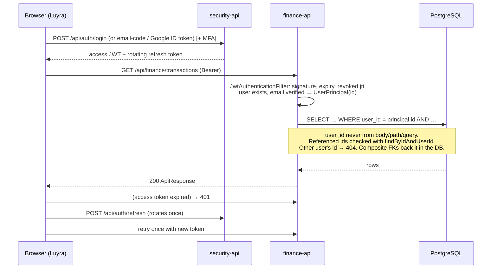
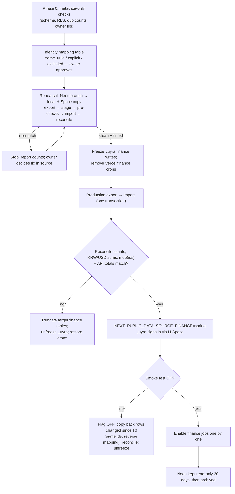
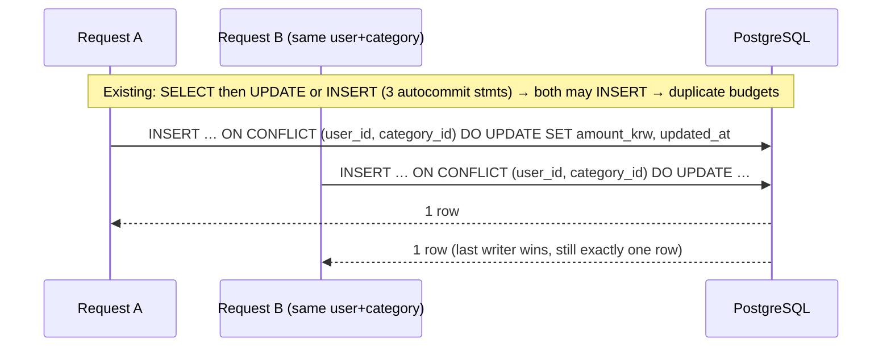

# Workflows

Each section shows the **existing** Luyra flow (VERIFIED from code) and,
where it differs, the **proposed** Spring flow (PROPOSED). The
architecture diagrams are in
[CURRENT-ARCHITECTURE.md](CURRENT-ARCHITECTURE.md) (existing) and
[SPRING-ARCHITECTURE.md](SPRING-ARCHITECTURE.md) (proposed).

## 1. Transaction creation

**Existing (Luyra)**



**Proposed (Spring)**

```mermaid
sequenceDiagram
  participant C as Client adapter
  participant F as JWT filter (security-api)
  participant TC as TransactionController
  participant TS as TransactionServiceImpl
  participant Repo as Repositories
  participant DB as PostgreSQL
  C->>F: Bearer token, Idempotency-Key?
  F-->>TC: UserPrincipal (401 if invalid/revoked/unverified)
  TC->>TC: @Valid TransactionRequest (400 + field map)
  TC->>TS: create(userId, req, key)
  activate TS
  Note over TS: @Transactional
  TS->>Repo: findByUserIdAndRequestId(key) → replay returns existing
  TS->>Repo: category = findByIdAndUserId → 404; type compatible → 400
  TS->>Repo: paymentMethod = findByIdAndUserId → 404
  TS->>TS: KrwConverter: original.multiply(rate).setScale(0, HALF_UP)
  TS->>Repo: save(FinanceTransaction)
  Repo->>DB: INSERT (composite FKs, CHECKs, unique request_id)
  deactivate TS
  TS-->>TC: TransactionResponse
  TC-->>C: 200 ApiResponse{data}
```

## 2. Savings contribution



## 3. Recurring-transaction processing



## 4. Authentication and data ownership



## 5. Migration and rollback



## 6. Budget upsert (missing-unique fix)


